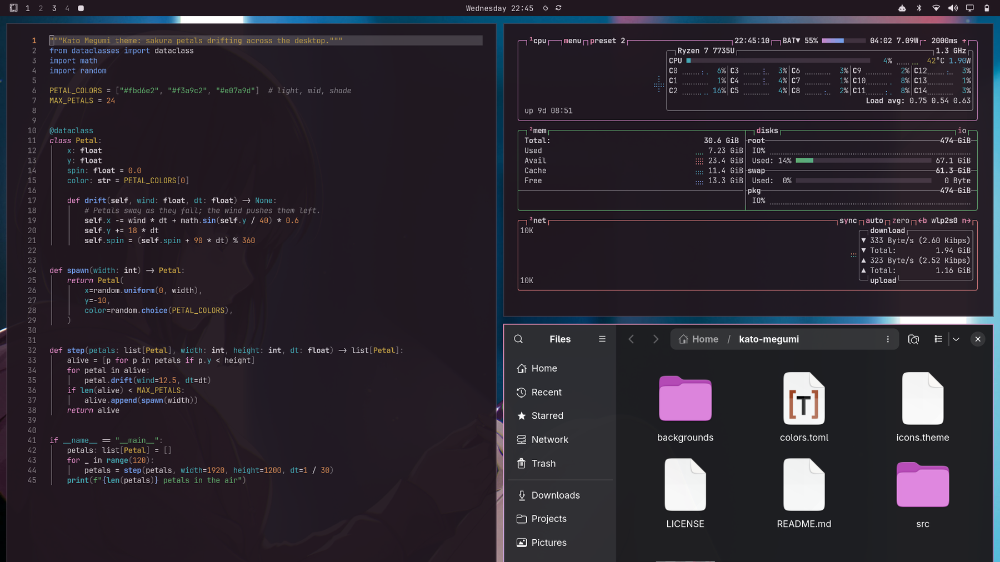
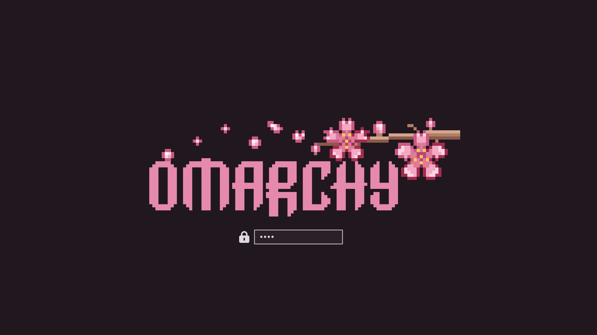

# Kato Megumi Dark

A calm dusk-plum dark theme for [Omarchy](https://omarchy.org), inspired by Kato Megumi from *Saenai Heroine no Sodatekata*.



## Install

```bash
omarchy theme install https://github.com/SoujiOkita98/omarchy-kato-megumi-dark-theme
```

Companion theme: **[Kato Megumi](https://github.com/SoujiOkita98/omarchy-kato-megumi-theme)**

## Design

- **Dark** Omarchy theme inspired by Kato Megumi (Saekano): dusk plum from her hair, sakura pink accent.
- Dusk plum background (`#21171f`, never pure black) with soft white text (12.5:1, no glare).
- Every color that can appear as text, including terminal colors and the dim gray, is at least **4.5:1** (WCAG AA) on the background.
- Lighter, softer terminal colors tuned in OKLCH for distinct hues.
- Sakura pink → lavender → plum window-border gradient.
- Yaru-magenta-dark icons.

## Boot screen

The theme ships a sakura pixel-art Omarchy logo (`unlock.png`). To use it on the
boot / disk-unlock screen:

```bash
omarchy plymouth set-by-theme kato-megumi-dark
```



## Wallpapers

| # | File | Artist | Source |
|---|---|---|---|
| 1 | `01-F13-clean_…wq968q.png` | unconfirmed (artbook page; cropped to remove the page margin) | [wallhaven wq968q](https://wallhaven.cc/w/wq968q) |
| 2 | `02-G10_…l3z38q.jpg` | unknown | [wallhaven l3z38q](https://wallhaven.cc/w/l3z38q) |
| 3 | `03-O11_…d5plzm.jpg` | Misaki Kurehito* | [yande.re](https://yande.re/post/show/356486) via [wallhaven d5plzm](https://wallhaven.cc/w/d5plzm) |
| 4 | `04-O06_…28edg6.png` | Misaki Kurehito* | [wallhaven 28edg6](https://wallhaven.cc/w/28edg6) |

## Artwork & takedown

The wallpapers are **not** my work and are **not** covered by this repo's license.
Kato Megumi and *Saenai Heroine no Sodatekata* (Saekano) belong to Fumiaki Maruto,
Misaki Kurehito and their publishers. This is a free, non-commercial fan theme.

**Support the creators.** This theme exists because of Misaki Kurehito's illustrations
and Fumiaki Maruto's story. If you love Megumi too, please support the official
*Saekano* light novels, art books and Blu-rays.

\* Artist attributions come from Wallhaven's tags and have not been independently
verified. If you are the artist or rights holder of any image here and want it
credited differently or removed, please [open an issue](../../issues) and I will
fix it or take it down promptly.

The logo in `unlock.png` is the Omarchy logo (from the Omarchy project), recolored,
with original pixel-art sakura added.

## License

The theme files (`colors.toml`, `icons.theme`, and the sakura pixel art) are MIT
licensed; see [LICENSE](LICENSE). Artwork is excluded, as described above.
